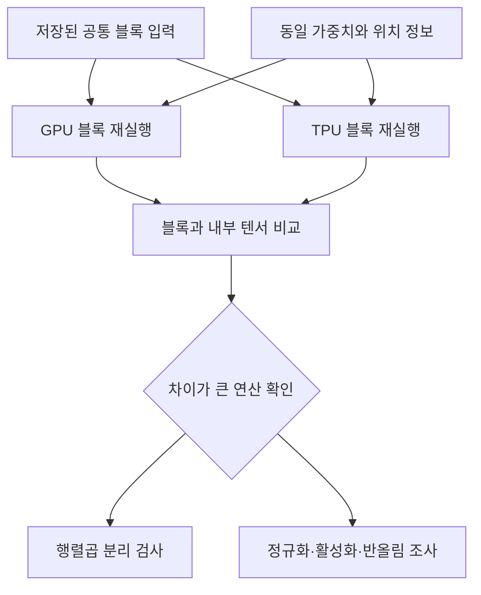
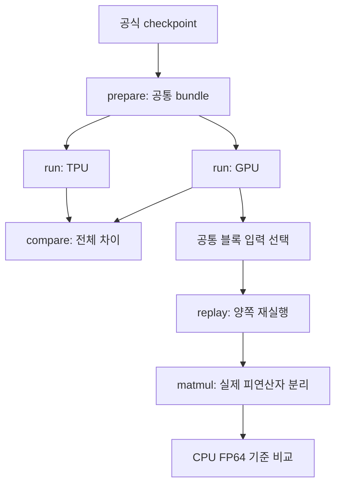

# GPU·TPU 레이어 수치 비교: 원리부터 결과 해석까지

이 문서는 AI 수학과 JAX를 처음 접하는 분도 코드를 따라갈 수 있도록 작성했습니다. 설명하는 대상은 이 저장소의 **Qwen2 진단 구현**입니다. 모든 GPU·TPU 모델의 일반 동작이나 운영 vLLM의 구현을 대신 설명하지는 않습니다.

## 1. 우리가 확인하려는 것

같은 모델 파일과 같은 문장을 넣어도 GPU와 TPU의 중간 계산값은 조금씩 다를 수 있습니다. 이 실험은 다음 질문에 답합니다.

1. 어느 블록에서 차이가 관찰되는가?
2. 그 차이는 앞선 블록에서 전달됐는가, 해당 블록에서 새로 생겼는가?
3. 차이가 행렬곱, 정규화, attention, 활성화 함수 중 어디와 관련되는가?
4. 최종 토큰 점수와 선택에 영향을 주는가?

"TPU가 GPU보다 정확하다"처럼 장비 전체를 평가하는 결론을 먼저 정하지 않습니다. 비교의 직접 대상은 **특정 가중치·입력·정밀도·소프트웨어 설정으로 실행한 결과**입니다.

## 2. 최소한 알아둘 용어

| 용어 | 쉬운 설명 | 이 도구에서의 예 |
|---|---|---|
| Token | 문장을 모델이 처리하는 조각 | 준비 단계에서 숫자 ID로 변환 |
| Tensor | 숫자를 여러 축으로 배열한 것 | `[1,128,896]` |
| Shape | 각 축의 크기 | 배치 1개, 토큰 128개, 특징 896개 |
| Weight | 학습으로 정해진 변환 계수 | Q projection 행렬 |
| Activation | 입력을 계산하면서 생기는 값 | 블록 입력·출력 |
| Hidden state | 각 토큰의 내부 특징 벡터 | 토큰마다 896개 숫자 |
| Block | Attention·MLP 등을 묶은 단위 | 기본 모델의 24개 Transformer 블록 |
| Logits | 다음 토큰 후보별 점수 | 토큰 위치마다 151,936개 점수 |
| Prefill | 주어진 입력 전체를 처리하는 단계 | 이 버전이 지원하는 실행 |
| Decode | 새 토큰을 하나씩 이어 만드는 단계 | 이 버전에서는 구현하지 않음 |
| Kernel | 장비에서 실제 연산을 수행하는 구현 | GPU·TPU backend가 선택한 행렬곱 |
| Accumulation | 여러 곱셈 결과를 더하는 과정 | 내적의 합산 |
| JIT | 함수를 실행 가능한 장비 코드로 컴파일하는 방식 | `jax.jit`로 블록 함수 컴파일 |
| Numerical parity | 수치 결과가 어느 정도 일치하는지 검사 | 동일 입력의 레이어 출력 비교 |

## 3. 행렬곱에서 무엇이 계산되는가?

행렬곱의 한 원소는 다음과 같습니다.

$$C_{ij}=\sum_{k=1}^{K}A_{ik}B_{kj}$$

`A`의 한 행과 `B`의 한 열에서 대응하는 수를 곱한 뒤 전부 더합니다. 예를 들어 `[1,2,3]`과 `[4,5,6]`의 내적은 `1×4+2×5+3×6=32`입니다.

행렬 크기가 `A[M,K]`, `B[K,N]`이면 결과는 `C[M,N]`입니다. 가운데 크기 K는 같아야 합니다. K가 합산하는 항의 수입니다.

실제 모델의 Q projection에서는 입력 특징을 새 특징으로 변환합니다.

$$Q=XW_Q^T+b_Q$$

PyTorch 형식의 가중치는 `[출력 특징, 입력 특징]` 순서로 저장됩니다. 따라서 이 코드에서는 `W.T`를 곱합니다. 전치 없이 비교하면 수치 정밀도의 차이가 아니라 다른 수식을 비교하게 됩니다.

### 실제 기본 모델의 크기

공식 Qwen2.5-0.5B-Instruct 설정의 hidden size는 896, attention head는 14개, KV head는 2개입니다. 따라서 head당 특징 수는 `896÷14=64`입니다.[S1]

| 값 | 128토큰 입력에서의 shape | 의미 |
|---|---|---|
| token ID | `[1,128]` | 배치 1개의 입력 |
| 블록 입력 X | `[1,128,896]` | 토큰별 896차원 특징 |
| Q 가중치 | `[896,896]` | 입력 896 → Q 896 |
| K/V 가중치 | 각각 `[128,896]` | 입력 896 → 2개 KV head × 64 |
| Q를 head로 분할 | `[1,14,128,64]` | 14개 query head |
| K/V를 head로 분할 | 각각 `[1,2,128,64]` | 2개 KV head |
| K/V를 Q head에 대응 | 각각 `[1,14,128,64]` | GQA 대응을 위해 이 진단 구현에서 반복 |
| Attention score | `[1,14,128,128]` | query 토큰과 key 토큰의 관계 |
| MLP gate/up | 각각 `[1,128,4864]` | 넓어진 중간 특징 |
| MLP down·블록 출력 | `[1,128,896]` | 다음 블록으로 전달 |
| Logits | `[1,128,151936]` | 각 위치의 다음 토큰 점수 |

GQA는 여러 query head가 일부 key/value head를 공유하는 구조입니다. 이 진단 구현은 이해와 관찰을 위해 K/V를 반복합니다. 운영 커널은 같은 수학을 다른 메모리 처리 방식으로 구현할 수 있습니다.

## 4. 같은 계산인데 왜 값이 달라질까?

### 4.1 컴퓨터가 저장할 수 있는 소수 자릿수는 유한하다

FP32, BF16은 실수를 유한한 비트로 표현합니다. 표현할 수 없는 값은 가까운 값으로 반올림됩니다. BF16은 FP32보다 가수부가 짧아서 숫자의 세밀한 차이를 덜 보존합니다.

BF16에서 1 근처의 인접 표현 간격은 `2^-7 = 0.0078125`입니다. 이는 **레이어 오차가 항상 0.78125%라는 뜻이 아닙니다.** 값의 크기, 합산, 상쇄, 출력 반올림에 따라 실제 차이가 달라집니다.

### 4.2 덧셈을 묶는 순서가 다를 수 있다

정확한 실수 계산에서는 `(a+b)+c`와 `a+(b+c)`가 같습니다. 유한 정밀도에서는 중간 반올림 때문에 다를 수 있습니다. 큰 양수와 큰 음수가 상쇄되는 계산에서 특히 확인하기 쉽습니다.

GPU·TPU의 병렬 분할, 타일 크기, reduction 순서, 선택한 커널이 다르면 같은 수식도 같은 비트 패턴을 보장하지 않습니다. PyTorch 공식 수치 정확도 문서도 플랫폼·연산 순서에 따른 차이를 설명합니다.[S2]

### 4.3 입력·누산·출력 자료형은 서로 다르다

| 위치 | 이 진단 구현의 정책 |
|---|---|
| bundle 가중치 저장 | checkpoint 값을 FP32로 정확히 확장 |
| BF16 실험의 장비 가중치·활성값 | BF16 |
| 행렬곱 | FP32 누산/출력을 요청 |
| 행렬곱 뒤 활성값 | 지정한 BF16 또는 FP32로 명시적 변환 |
| RMSNorm 통계·softmax 계산 | FP32 |
| 파일에 저장하는 중간값 | FP32 |
| 두 파일의 차이 계산 | CPU FP64 |

BF16 값을 FP32 파일로 저장해도 사라진 정밀도가 복원되지는 않습니다. FP32가 해당 BF16 값을 정확히 담을 수 있어 파일을 읽고 비교하기 편해지는 것입니다.

`--precision highest`도 BF16 입력을 학습 당시의 원래 FP32 값으로 바꾸지 않습니다. FP32 연산의 내부 matmul 정밀도 정책과 입력 dtype을 구분해야 합니다.[S3]

### 4.4 연산을 합치면 반올림 경계가 달라질 수 있다

이 코드의 `linear()`는 행렬곱 결과를 활성 dtype으로 변환한 다음 bias를 더합니다. 운영 fused addmm는 bias를 더하는 시점이나 반올림 시점이 다를 수 있습니다. 따라서 **같은 수학적 모델**과 **동일한 커널의 비트 단위 동작**은 구분합니다.

## 5. 전체 실행과 동일 입력 재실행은 다른 질문에 답한다

레이어 번호 l의 함수가 F이고 입력이 h라면 전체 실행은 다음 두 값을 비교합니다.

$$F_l^{GPU}(h_{l-1}^{GPU})\quad\text{와}\quad F_l^{TPU}(h_{l-1}^{TPU})$$

앞선 블록에서 차이가 생겼다면 두 입력 자체가 이미 다릅니다. 따라서 현재 블록의 출력 차이만으로 현재 블록이 원인이라고 단정할 수 없습니다.

replay는 저장된 입력 하나를 공통으로 사용합니다.

$$F_l^{GPU}(h_{common})\quad\text{와}\quad F_l^{TPU}(h_{common})$$

기본 실행은 cache가 없는 prefill입니다. 위치 정보는 입력 길이에 맞춰 0부터 생성합니다. KV cache를 사용하는 decode 실험으로 확장하려면 hidden state만 맞춰서는 부족합니다. cache, 위치, mask까지 동일하게 준비해야 합니다.

전체 실행의 차이와 replay 차이를 숫자로 빼서 '누적 오차 기여율'로 해석하면 안 됩니다. 두 실행의 입력과 비선형 반응이 다르기 때문입니다.

## 6. Transformer 블록 안의 계산

이 구현은 정규화를 먼저 수행하는 구조입니다.

| 순서 | 연산 | 역할 | 코드에서 저장하는 이름 |
|---|---|---|---|
| 1 | RMSNorm | 특징 벡터 크기를 정리 | `input_norm` |
| 2 | Q/K/V projection | 비교·조회에 쓸 특징 생성 | `q_proj`, `k_proj`, `v_proj` |
| 3 | RoPE | 토큰 위치 정보 반영 | `q_rope`, `k_rope` |
| 4 | QKᵀ/√d | 토큰끼리의 관계 점수 | `scores_unmasked` |
| 5 | Causal mask + softmax | 미래 토큰을 제외하고 가중치 생성 | `attention_probs` |
| 6 | 확률×V + output projection | 다른 토큰 정보 결합 | `context`, `attention_output` |
| 7 | 잔차 더하기 | 원래 입력과 변환값 합치기 | `attention_residual` |
| 8 | RMSNorm + MLP | 특징을 넓혔다가 다시 줄이기 | `post_attention_norm`, `gate_proj`, `up_proj`, `silu_gate`, `gated_product`, `down_proj` |
| 9 | 잔차 더하기 | 다음 블록의 입력 생성 | `output` |

RMSNorm은 각 토큰 벡터의 제곱 평균으로 크기를 조정합니다. `eps`는 0으로 나누는 상황을 완화하는 작은 상수입니다. 양쪽 eps가 다르면 하드웨어 비교 조건이 달라집니다.

RoPE는 Q와 K에 위치에 따른 회전을 적용합니다. 128번째 토큰을 한쪽은 위치 127, 다른 쪽은 128로 계산하면 다른 입력 조건입니다.

Causal mask는 현재 위치에서 미래 토큰을 참조하지 않도록 막습니다. `scores_unmasked`는 mask 적용 전 전체 점수이므로 미래 위치의 차이도 들어 있습니다. 그 위치의 차이를 실제 출력에 영향을 주는 차이와 곧바로 동일시하지 않습니다.

MLP에서는 두 projection 결과를 사용합니다. 이 구현의 식은 다음과 같습니다.

$$MLP(x)=W_{down}\bigl(SiLU(W_{gate}x)\odot(W_{up}x)\bigr)$$

여기서 `⊙`는 같은 위치의 원소끼리 곱한다는 뜻입니다. 위 식은 역할을 설명하기 위한 열벡터 표기입니다. 실제 코드의 행벡터 입력은 각 가중치를 전치해 사용합니다.

## 7. 코드와 데이터가 이동하는 경로

| 소스 | 주요 함수 | 읽거나 만드는 데이터 |
|---|---|---|
| `src/parity/__main__.py` | `main` | CLI 인자 해석·검증, 명령 분기 |
| `src/parity/prepare.py` | `download`, `prepare` | revision 고정, 가중치 변환, token ID |
| `src/parity/io.py` | `verify_bundle`, `load_weights` | manifest와 실제 파일의 일치 확인 |
| `src/parity/model.py` | `block`, `get_block`, `logits` | 모델 수식과 JIT 함수 |
| `src/parity/run.py` | `run`, `replay`, `matmul` | 장비 실행, 중간값과 환경 기록 |
| `src/parity/metrics.py` | `metrics` | CPU FP64 차이 계산 |
| `src/parity/compare.py` | `compare`, `plot` | 조건 검증, CSV·문서·그래프 |
| `src/parity/smoke.py` | `create_fixture`, `smoke` | 작은 합성 입력으로 연결 확인 |

### 코드에서 블록 하나를 읽는 순서

1. `run()`이 bundle checksum을 확인합니다.
2. `setup()`이 요청 backend를 강제하고 실제 device를 선택합니다.
3. `device_weights()`가 가중치를 지정 dtype/device로 올립니다.
4. embedding lookup으로 첫 hidden state를 얻습니다.
5. `get_block(..., capture=False)`의 함수를 각 레이어에 적용합니다.
6. 선택한 레이어는 `capture=True` 함수로도 계산해 중간값을 저장합니다.
7. 다음 레이어에는 항상 `capture=False`의 출력을 전달합니다.
8. 마지막 정규화와 head로 logits를 계산합니다.

이 구조는 블록 단위 JIT입니다. 운영 엔진의 전체 그래프 fusion과 동일한 경계를 재현하지 않습니다. 중간값을 파일로 복사하는 비용도 있으므로 이 실행시간을 추론 처리량 지표로 사용하지 않습니다.

## 8. 기록하는 파일과 비교 조건

### 입력 묶음

| 파일 | 의미 |
|---|---|
| `config.json` | 모델 구조 |
| `weights/*.npy` | 원본 checkpoint 값을 FP32로 확장한 가중치 |
| `inputs/*.npy` | 같은 token ID |
| `prompts.json` | 원문, 사용 길이, 입력 생성 정보 |
| `manifest.json` | 파일별 SHA-256과 원본 checkpoint 정보 |

체크섬은 두 실험에서 같은 파일을 사용했는지 확인하는 장치입니다. 모델 구조·입력 정책이 올바르다는 사실 자체를 증명하지는 않습니다.

### 실행 결과

`run.json`에는 backend, device, dtype, precision, JAX/JAXLIB/NumPy 버전, 코드 SHA-256, 실행 모드가 들어갑니다. replay는 공통 입력 해시, matmul은 장비에 들어간 실제 피연산자의 해시도 기록합니다.

비교 도구는 bundle·코드·모드·공통 입력 등이 다르면 중단합니다. dtype·precision·주요 버전 차이는 기본적으로 중단하지만, 의도된 설정 비교는 `--allow-setting-differences`로 허용할 수 있습니다. 이 옵션은 bundle이나 공통 입력 불일치를 무시하지 않습니다.

환경 플래그도 기록하지만 모든 플래그의 동일성을 자동 보장하지는 않습니다. 보고서 작성 시 `run.json`의 `flags`도 확인합니다. 전체 tensor 파일에 대한 서명이나 전송 완료 검증을 제공하는 기능은 아닙니다. 비교 전에 결과 복사를 완료해야 합니다.

## 9. 비교 지표를 숫자로 이해하기

작은 예로 `A=[1,2]`, `B=[1.001,1.999]`를 비교하겠습니다. 각 원소의 절대 차이는 모두 0.001입니다.

| 지표 | 식·뜻 | 예시 값 |
|---|---|---:|
| 최대 절대 차이 | max(abs(A−B)) | 0.001 |
| MAE | 절대 차이의 평균 | 0.001 |
| RMSE | 제곱 차이 평균의 제곱근 | 0.001 |
| 정규화 L2 | ‖A−B‖₂ / max(‖A‖₂,‖B‖₂,ε) | 약 0.00063246 |
| P99 | 절대 차이의 99백분위 | 이 예에서는 0.001 |

정규화 L2는 약 0.0632%입니다. 이는 전체 벡터 크기 대비 차이이며, 모든 원소의 상대 차이가 그 비율이라는 뜻은 아닙니다.

### 지표별 주의점

- 최대 차이만 보면 극소수 위치에 판단이 치우칠 수 있습니다. MAE·P99도 같이 봅니다.
- 코사인 유사도는 방향을 봅니다. A와 2A의 방향은 같으므로 크기 차이를 놓칠 수 있습니다.
- 원소별 상대 오차는 기준값이 0에 가까우면 커집니다. 이 도구는 대칭적인 전체 L2도 제공합니다.
- NaN/Inf가 하나라도 있는 tensor는 정상 오차 통계로 평균 내지 않습니다. 지표는 null로 두고 개수를 기록합니다.
- 정상적인 모델 범위에서 비교하도록 설계했습니다. FP64 범위를 넘는 극단값의 엄밀한 수치 분석 도구는 아닙니다.

### 허용치 초과율

이 도구는 다음 조건을 만족하지 않는 원소의 비율을 기록합니다.

$$|A_i-B_i|\le atol+rtol\cdot\max(|A_i|,|B_i|)$$

`atol`은 값이 작은 구간의 절대 허용량이고, `rtol`은 값의 크기에 비례한 허용량입니다. 기본값은 진단용입니다. BF16이면 무조건 특정 rtol을 통과해야 한다는 규칙은 두지 않습니다.

## 10. Logits와 실제 출력의 관계

logits는 점수입니다. softmax를 거치면 토큰 확률로 해석할 수 있습니다. 이 도구의 Top-1 일치율은 각 입력 위치에서 가장 높은 점수의 토큰 ID가 같은지 봅니다.

예를 들어 두 후보의 점수가 10.000과 9.999라면 작은 수치 차이로 순위가 바뀔 수 있습니다. 따라서 Top-1과 함께 1·2위 점수 간격도 봅니다.

현재 보고서의 `left_min_top1_margin`은 좌측 결과에서 관찰한 가장 작은 간격입니다. 전체 토큰별 margin 분포를 대신하지 않습니다. 각 위치의 Top-1은 고정된 입력 문맥에서의 선택입니다. 실제로 생성한 문장 전체의 일치율이나 일반 벤치마크 정확도가 아닙니다.

생성 실험으로 확장하면 첫 토큰이 달라진 뒤 두 모델은 서로 다른 문맥을 보게 됩니다. 미세 수치 비교를 계속하려면 다음 입력 토큰열을 강제로 동일하게 유지하는 별도의 실행 경로가 필요합니다.

## 11. FP64 기준 계산은 어떻게 쓰나?

`matmul`은 저장된 input_norm과 실제 Q 가중치를 사용합니다. GPU 또는 TPU에 들어간 반올림 완료 값을 CPU로 되가져와 FP64로 변환하고 기준 곱셈을 수행합니다.

다음 세 값을 구분합니다.

1. 장비의 FP32 출력 요청 결과: `accumulator_fp32.npy`.
2. 활성 dtype으로 변환한 결과: `rounded_activation.npy`.
3. CPU FP64 계산 결과: `reference_fp64.npy`.

BF16 실험의 FP64 기준에 반올림 전 원본 FP32 입력을 넣으면 입력 정밀도 손실까지 섞입니다. 그래서 이 도구는 실제 장비 피연산자를 기준으로 삼습니다. 기준 계산도 유한 정밀도이며 수학적 완전 정답이라고 부르지는 않습니다.

이 GEMM 실험은 bias를 제외합니다. 전체 Q projection과 비교하려면 bias와 반올림 순서까지 맞춰야 합니다. FP32 출력 요청은 칩 내부 모든 부분 누산값을 읽는 기능이 아닙니다.

## 12. 계측이 계산을 바꿀 수 있다

중간값을 외부로 반환하면 컴파일러가 연산을 합치던 방식이 달라질 수 있습니다. JAX 공식 문서도 debug 출력이 fusion과 수치 결과에 영향을 줄 수 있다고 설명합니다.[S4]

이 도구는 선택한 블록에서 plain 출력과 중간값을 반환하는 traced 출력을 비교합니다. 그 결과가 `instrumentation_checks.json`입니다. 차이가 0이면 해당 실행에서 그 블록 출력은 같았다는 뜻입니다. 모든 중간 연산이나 다른 장비에서도 영향이 없다는 보장은 아닙니다.

전체 모델의 완전한 비계측·단일 그래프 실행과 비교하는 기능은 현재 없습니다. 결과를 운영 엔진의 비트 단위 재현으로 해석하지 않는 이유입니다.

## 13. 실험을 어떻게 확장하나?

| 단계 | 변경하는 것 | 고정할 것 | 확인할 결과 |
|---|---|---|---|
| A | 같은 장비에서 반복 | 모든 입력·설정 | 자체 변동 |
| B | GPU ↔ TPU | bundle, 소스, dtype, shape | 전체 블록 차이 |
| C | 동일 블록 입력 replay | 공통 hidden state·가중치 | 해당 블록 자체의 차이 |
| D | Q projection GEMM 분리 | 실제 A·B | FP64 기준 대비 차이 |
| E | BF16 ↔ FP32 | checkpoint·입력·모델 수식 | 정밀도 영향 |
| F | 128 → 512 → 2,048토큰 | 나머지 조건 | 길이에 따른 변화 |

길이를 바꾸면 입력 내용과 shape, 커널 선택이 함께 바뀔 수 있습니다. '누산 길이만의 영향'을 보고 싶다면 연산 단위 실험에서 변수를 더 제한해야 합니다.

## 14. 저장량을 미리 계산하기

저장 파일은 FP32가 기본입니다. 원소 수에 4 bytes를 곱하면 압축 전 크기를 추정할 수 있습니다.

기본 모델의 logits 한 개는 `T×151,936×4 bytes`입니다.

| 입력 길이 T | sample 1개·반복 1회의 logits |
|---:|---:|
| 128 | 약 77.8 MB |
| 512 | 약 311.2 MB |
| 2,048 | 약 1.245 GB |

MB/GB는 10진 단위입니다. sample 3개·반복 3회면 위 값의 9배이고, 블록 입출력·상세 계측 파일은 별도입니다. `[1,14,T,T]`인 attention score 하나는 `14×T²×4 bytes`이므로 길이를 2배 늘리면 저장량이 4배가 됩니다.

처음에는 모든 블록 입출력과 소수의 내부 레이어만 저장합니다. 차이가 큰 레이어를 찾은 뒤 replay로 자세히 보는 것이 저장량을 줄이는 방법입니다.

## 15. 결과 해석 예시

아래는 실제 실측 수치가 아니라 판단 방법을 설명하는 상황 예시입니다.

| 관찰 | 가능한 해석 | 다음 검사 |
|---|---|---|
| 전체 실행 차이는 크고 replay 차이는 작음 | 이전 블록에서 달라진 입력 영향 가능 | 앞선 블록을 조사 |
| 동일 입력 Q projection부터 차이가 큼 | 행렬곱·bias·반올림 경계 영향 가능 | GEMM과 FP64 비교 |
| score는 비슷한데 확률 차이가 증가 | softmax와 입력 점수 분포 영향 가능 | mask·scale·정밀도 확인 |
| 내부 차이가 작지만 Top-1이 일부 다름 | 후보 점수 간격이 작을 가능성 | logits margin 확인 |
| 같은 장비 반복도 다름 | 실행 변동이나 설정 문제 가능 | 반복 분포와 실행 조건 확인 |
| 계측 출력과 plain 출력이 다름 | 관찰을 위한 코드가 계산 경로에 영향 | 해당 상세 값의 해석 제한 |

"가능성"을 원인으로 확정하지 않습니다. 동일 입력 재실행과 설정을 하나씩 바꾸는 검사가 원인 판단의 근거입니다.

## 16. 현재 구현의 경계와 후속 작업

- 지원 대상은 Qwen2 계열 Dense의 제한된 구성입니다. sliding window, scaled RoPE, 양자화 checkpoint는 거부합니다.
- 모델 전체가 한 JAX device에 들어가야 합니다. 이 코드로 120B 모델을 자동 분산하지 않습니다.
- multi-device reduction, KV cache, decode, MoE routing, vLLM/Pallas 운영 커널은 아직 계측하지 않습니다.
- 모델 종류를 늘릴 때는 가중치 이름만 바꾸지 않습니다. 구조, 위치 정보, 정규화, head, bias, dtype 정책을 검증해야 합니다.
- 새로운 adapter는 작은 독립 reference 검사 → 실제 checkpoint CPU 검사 → GPU·TPU 실행 순서로 확인합니다.

## 근거와 추가 읽기

- [S1: Qwen 공식 config](https://huggingface.co/Qwen/Qwen2.5-0.5B-Instruct/blob/main/config.json)
- [S2: PyTorch Numerical accuracy](https://docs.pytorch.org/docs/stable/notes/numerical_accuracy.html)
- [S3: JAX Matmul precision](https://docs.jax.dev/en/latest/201/precision.html)
- [S4: JAX Debugging runtime values](https://docs.jax.dev/en/latest/201/debugging.html)
- [S5: Transformers Qwen2 v4.51.3 구현](https://github.com/huggingface/transformers/blob/v4.51.3/src/transformers/models/qwen2/modeling_qwen2.py)
- [S6: Google Cloud BF16 설명](https://docs.cloud.google.com/tpu/docs/bfloat16)

표의 모델 크기는 S1을 기준으로 계산했습니다. 실험 절차·지표 조합·확장 순서는 이 저장소를 위한 설계이며 벤더가 정한 합격 기준이 아닙니다.
