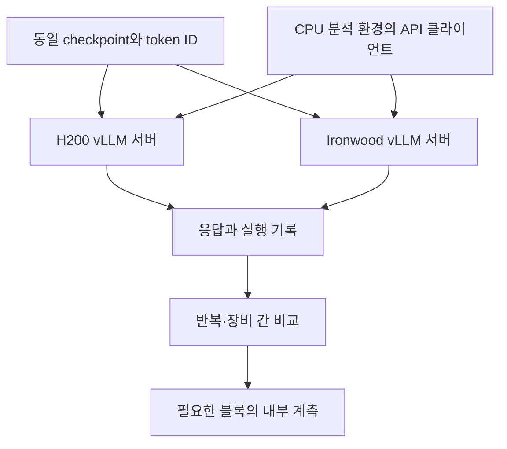

# vLLM 환경에서 GPU·TPU 수치를 비교하는 방법

확인일: 2026-11-02 · 도구 버전: 1.2.0

**가능합니다. 다만 API 출력 비교, 레이어 상태 추출, 실제 커널 재실행을 나누어 진행해야 합니다.** 기존 JAX 진단 도구는 공통 수식을 비교합니다. vLLM 검사는 실제 서빙 엔진의 모델 구현, 커널, cache, 스케줄러까지 포함합니다. 따라서 vLLM 결과의 차이를 하드웨어만의 차이로 해석하지 않습니다.

이 배포본에는 실제 endpoint에 연결할 수 있는 **API 비교 클라이언트**를 추가했습니다. 레이어별 vLLM worker adapter는 아직 구현하지 않았습니다. 아래 레이어 추출·커널 계측 절차는 공식 기능을 검토한 설계와 적용 후보이며, 사용자 H200·Ironwood에서 검증한 결과는 아닙니다.

## 1. 무엇을 어디까지 비교하나?

| 단계 | 관측값 | 알 수 있는 것 | 이 배포본 상태 |
|---|---|---|---|
| A. 고정 입력 API | 생성 token ID, 후보 raw logprob | 같은 문맥의 다음 토큰 선택·점수 차이 | 클라이언트 구현, 모형 HTTP 서버로 검사 |
| B. 블록 경계 | 중간 hidden state | 어느 블록부터 차이가 커지는지 | 공식 extraction 기능 적용 절차 제시 |
| C. 블록 내부 | Q/K/V, 정규화, attention, MLP | 차이가 나타나는 연산 경계 | backend별 worker adapter 설계 |
| D. 연산 재실행 | 동일 피연산자의 실제 커널 출력 | 특정 커널의 수치 차이 | vLLM 커널별 별도 구현 필요 |

단계 A의 API 클라이언트만으로 레이어별 행렬곱 오차를 측정했다고 표현하면 안 됩니다. top-k logprob는 전체 logits도 아닙니다.

## 2. TPU backend를 먼저 구분하기

현재 공식 프로젝트는 기존 `tpu-inference`를 **vLLM JAX**로 안내하며, PyTorch native TPU 경로는 **vllm-torchtpu** 프로젝트로 분리하고 있습니다. 실제 코드 이동과 배포 패키지명은 전환 중이므로 설치된 distribution, 소스 commit, 서버의 platform 로그를 함께 확인합니다.[S1][S2]

| 실행 경로 | 모델 실행·계측 관점 |
|---|---|
| H200의 vLLM GPU | PyTorch 모델 runner와 GPU custom kernel |
| Ironwood의 vLLM JAX / tpu-inference | JAX 모델·XLA 실행 경계에서 관측 필요 |
| Ironwood의 vLLM TorchTPU | PyTorch 모델 경로를 사용하지만 TPU lowering·custom kernel은 별도 |

PyTorch 모델 정의를 공유하면 구조 차이를 줄일 수 있습니다. 같은 모델 정의를 사용한다고 GPU·TPU kernel이나 반올림 경계까지 동일해지는 것은 아닙니다. TorchTPU 공식 문서도 `torch_tpu`와 JAX/Pallas 커널을 사용하는 구성을 설명합니다.[S2]

이미 운영 중인 TPU 환경을 곧바로 다른 backend로 교체하지 마세요. 먼저 현재 환경을 기준으로 API 검사를 하고, backend 교체 실험은 별도 결과로 기록합니다.

## 3. 환경은 세 곳으로 분리



기존 `scripts/setup.sh gpu|tpu`는 **공통 JAX 진단 환경 설치**입니다. 이를 vLLM 서버 venv에 실행하지 않습니다. vLLM이 요구하는 torch/JAX/libtpu 버전과 충돌할 수 있습니다. API 클라이언트는 CPU 분석 환경에서 실행하고 HTTP로 연결합니다. Docker-in-Docker는 필요하지 않습니다.

### 이미 동작하는 서버 환경이 있는 경우

그 환경을 우선 사용합니다. 각 서버 venv에서 다음을 기록합니다.

```bash
python -m pip freeze
python -m pip check
python -c 'import vllm; print(vllm.__version__)'
python -c 'from vllm.platforms import current_platform; print(current_platform.device_name)'
vllm serve --help
```

GPU에서는 `nvidia-smi`, JAX TPU 경로에서는 `python -c 'import jax; print(jax.devices())'`도 확인합니다. TorchTPU에서는 해당 backend의 공식 장비 확인 명령과 startup 로그를 사용합니다. 위 패키지 버전 출력만으로 실제 H200·Ironwood가 선택됐다고 단정하지 않습니다.

### 새 환경이 필요한 경우

H200의 별도 Linux/Python 3.12 venv 예시:

```bash
python3.12 -m venv .venv-vllm-gpu
source .venv-vllm-gpu/bin/activate
python -m pip install --upgrade pip
python -m pip install 'vllm==0.32.0'
python -m pip check
```

기존 `vllm-tpu` 배포 경로를 사용하는 별도 TPU venv 예시:

```bash
python3.12 -m venv .venv-vllm-tpu
source .venv-vllm-tpu/bin/activate
python -m pip install --upgrade pip
python -m pip install 'vllm-tpu==0.32.0'
python -m pip check
```

`vllm-tpu`는 `vllm`을 제공하는 배포 패키지입니다. 같은 venv에 GPU용 `vllm` wheel을 추가로 덮어 설치하지 않습니다. 0.32.0 TPU wheel의 배포는 확인했지만, 이 문서 작성 환경에서 GPU·TPU 서버 설치와 모델 구동은 수행하지 않았습니다.[S3]

TorchTPU를 선택하는 경우에는 **또 다른 가상환경**을 사용합니다. 2026-11-02 PyPI metadata를 직접 조회했을 때 combined package와 core의 배포 버전은 0.29.0이었습니다. 이 경로의 설치 후보는 다음과 같습니다.[S11]

```bash
python3.12 -m venv .venv-vllm-torchtpu
source .venv-vllm-torchtpu/bin/activate
python -m pip install --upgrade pip
python -m pip install --extra-index-url https://download.pytorch.org/whl/cpu \
  'vllm-torchtpu==0.29.0'
python -m pip check
```

위 TorchTPU wheel 경로와 GPU 0.32.0을 같은 core 버전이라고 취급하지 않습니다. 이 경우 GPU도 실제 TPU core와 맞춘 별도 환경을 사용합니다. 반면 [공식 소스 설치 문서](https://github.com/vllm-project/vllm-torchtpu/blob/main/docs/getting_started/installation.md)의 main은 vLLM 0.32.0 기반 소스 경로를 안내하고 있습니다. wheel 0.29.0과 main의 소스 환경을 혼합하지 말고, 선택한 plugin/core commit 쌍을 기록합니다. 설치 명령의 dependency 해석·하드웨어 초기화는 각 장비에서 추가 확인해야 합니다.

설치 후 양쪽의 vLLM core 버전·commit을 확인합니다. 정해진 TPU 플러그인이 다른 core를 요구한다면 GPU를 그 호환 버전에 맞추거나, 버전 차이를 포함한 서빙 스택 비교라고 기록합니다. JAX 진단 도구의 버전을 vLLM 서버에 강제로 맞추지는 않습니다.

## 4. 첫 실험 조건

아래는 원인 분석을 단순하게 하기 위한 **실험 제안**입니다. 벤더의 수치 합격 기준은 아닙니다.

| 항목 | 시작 조건 | 이유 |
|---|---|---|
| 모델 | 같은 revision의 Qwen2.5-0.5B-Instruct | 기존 JAX 결과와 연결하기 쉬움 |
| 입력 | 같은 token ID, 32/64/128토큰 prefix | 토큰화·템플릿 차이 제거 |
| weight/activation | BF16, 양자화 없음 | 자료형 변수를 줄임 |
| KV dtype | auto의 실제 결과가 BF16인지 양쪽 로그 확인 | 같은 문자열이라도 실제 형식 확인 필요 |
| 요청 | 한 번에 하나, max_tokens=1 | 고정 문맥의 마지막 prefill 위치 비교 |
| TP/PP | 가능하면 각각 1 | 분산 reduction 변수 제한 |
| Prefix cache | 비활성화 | cache 재사용 경로 배제 |
| Chunked prefill | 비활성화 | 토큰 분할 경로 제한 |
| Speculative decoding | 비활성화 | draft/검증 경로 제거 |
| 반복 | 각 서버에서 3회 이상 | 자체 변동과 장비 간 차이 구분 |

TPU backend가 특정 장비 수나 병렬도를 요구하면 지원되는 구성을 사용하고 차이를 기록합니다. `TP=1`만으로 실제 TPU 칩 하나가 사용된다고 가정하지 않습니다. Ironwood의 JAX device와 물리 칩도 구분합니다.

`gpu-memory-utilization=0.9`처럼 같은 비율을 써도 KV cache bytes가 같아지지는 않습니다. 수치 실험에서는 실제 KV dtype·block 수·할당량·context를 기록하고, 메모리·처리량 비교는 별도 벤치마크로 수행합니다.

## 5. 서버 실행 예시

한 번 내려받은 **원본 checkpoint 폴더**를 양쪽 서버에 복사합니다. JAX용 `bundle/weights/*.npy`는 vLLM checkpoint가 아닙니다. 아래 `/models/checkpoint-qwen`은 원본 `config.json`, tokenizer, safetensors가 있는 실제 경로로 바꿉니다.

두 서버에서 같은 명령을 사용합니다. 설치된 backend가 해당 flag를 지원하는지 `--help`와 startup 로그로 확인합니다.

```bash
vllm serve /models/checkpoint-qwen \
  --served-model-name parity-qwen \
  --dtype bfloat16 --kv-cache-dtype auto \
  --tensor-parallel-size 1 --pipeline-parallel-size 1 \
  --max-model-len 256 --max-num-seqs 1 --max-num-batched-tokens 256 \
  --no-enable-prefix-caching --no-enable-chunked-prefill \
  --generation-config vllm --max-logprobs 20 --logprobs-mode raw_logprobs \
  --host 127.0.0.1 --port 8000
```

`raw_logprobs`는 temperature·penalty 같은 후처리 전 분포의 로그 확률입니다. `raw_logits`와 혼용하지 않습니다. 이 클라이언트는 raw logprob 비교만 제공합니다.[S4]

GKE에서는 기존 서버 Pod의 포트를 관리 PC로 연결할 수 있습니다. 각 터미널에서 유지합니다. namespace·context는 실제 환경에 맞춥니다.

```bash
# 터미널 1
kubectl port-forward pod/YOUR_GPU_POD 18000:8000
```

```bash
# 터미널 2
kubectl port-forward pod/YOUR_TPU_POD 18001:8000
```

내부에서 함께 추론 중인 요청이 있으면 batch 구성이 달라질 수 있습니다. 이 실험은 전용 서버 또는 요청을 통제할 수 있는 환경에서 수행합니다.

## 6. 실행 기록과 공통 입력 만들기

### 각 서버에서 실행 기록

`examples/vllm_server_config.json`은 선언용 예제입니다. **실제 startup 설정을 확인한 뒤** 값을 수정하세요. 설정 파일을 만들었다고 서버가 그 설정으로 바뀌지는 않습니다.

GPU 서버 venv에서:

```bash
python scripts/vllm_api_probe.py record \
  --model-dir /models/checkpoint-qwen \
  --config examples/vllm_server_config.json \
  --backend gpu --device H200 --out runs/gpu-server-record.json
```

TPU 서버 venv에서는 `--backend tpu --device Ironwood --out runs/tpu-server-record.json`로 실행합니다. 스크립트와 config만 복사해도 record는 실행할 수 있습니다. parity/JAX 분석 환경을 서버에 설치할 필요가 없습니다.

이 기록은 디스크의 모델 파일 SHA-256, 설치 패키지 버전, 운영자가 선언한 설정을 담습니다. **해당 endpoint 프로세스가 실제 그 파일을 읽었다는 원격 증명은 아닙니다.** 서버 시작 로그·실행 명령·이미지 digest 또는 Git commit을 함께 보관하고, 수집 중 모델 교체를 하지 않습니다.

### 분석 PC에서 입력 생성

기존 빠른 실행에 따라 `data/bundle-128`을 준비한 CPU 환경에서 실행합니다.

```bash
python scripts/vllm_api_probe.py export \
  --bundle data/bundle-128 --prefix-lengths 32 64 128 \
  --out data/vllm-inputs.json
```

각 prompt의 처음 32/64/128개 token ID를 고정합니다. 원문 문자열을 서버에서 다시 토큰화하지 않습니다. 채팅 템플릿도 적용하지 않습니다. 업무 chat 형식을 비교하려면 준비 단계에서 템플릿을 한 번 적용한 token ID를 별도로 만들어 공유하세요.

## 7. 실제 endpoint 수집·비교

서버 기록 JSON 두 개를 분석 PC의 `runs/`로 가져옵니다. 분석 PC에서 실행합니다.

```bash
python scripts/vllm_api_probe.py capture \
  --endpoint http://127.0.0.1:18000/v1 --model parity-qwen \
  --inputs data/vllm-inputs.json --server-record runs/gpu-server-record.json \
  --repeats 3 --top-k 20 --out runs/vllm-gpu

python scripts/vllm_api_probe.py capture \
  --endpoint http://127.0.0.1:18001/v1 --model parity-qwen \
  --inputs data/vllm-inputs.json --server-record runs/tpu-server-record.json \
  --repeats 3 --top-k 20 --out runs/vllm-tpu

python scripts/vllm_api_probe.py compare \
  --left runs/vllm-gpu --right runs/vllm-tpu \
  --out reports/vllm-gpu-vs-tpu
```

인증이 필요한 서버는 해당 터미널에서 `VLLM_API_KEY` 환경변수로 키를 제공할 수 있습니다. 클라이언트는 키를 결과에 저장하지 않습니다. 양쪽 키가 다르면 각 capture 전에 해당 키를 사용합니다.

같은 서버 반복도 검사합니다. TPU도 같은 방식으로 실행합니다.

```bash
python scripts/vllm_api_probe.py compare \
  --left runs/vllm-gpu --right runs/vllm-gpu \
  --left-repeat 0 --right-repeat 1 --out reports/vllm-gpu-repeat
```

수집기는 응답의 `prompt_token_ids`가 보낸 입력과 같은지 확인합니다. 생성 토큰과 후보들도 `token_id:N` 형식으로 대조합니다. 해당 응답 필드나 logprobs가 없으면 중단합니다. 문자열 비교로 자동 대체하지 않습니다. vLLM의 관련 필드는 공식 completion protocol에 정의돼 있지만 TPU plugin별 실제 지원은 별도로 확인해야 합니다.[S5]

| 결과 파일 | 내용 |
|---|---|
| `responses/*.json` | 원본 응답 |
| `observations.json` | token ID 기준의 비교용 값 |
| `run.json` | 고정 입력, 요청 설정, 서버 기록, 완료 여부 |
| `metrics.csv` | 입력별 선택 일치, 공통 후보 점수 차이 |
| `report.md`, `summary.json` | 결과 요약과 선언 설정 차이 |

모델 파일·입력·요청 조건이 다르면 비교를 중단합니다. 서버 선언 설정이 의도적으로 다를 때만 `--allow-config-differences`를 사용할 수 있습니다. 패키지 버전은 양쪽 값을 보고서에 기록합니다. GPU·TPU의 서로 다른 runtime을 자동으로 같은 환경이라고 판정하지 않습니다.

## 8. API 지표를 읽는 법

- `generated_token_agreement`: 같은 입력에서 실제 선택된 token ID가 같은지.
- `returned_candidate_jaccard`: 양쪽이 반환한 후보 집합의 교집합 크기 / 합집합 크기.
- `common_logprob_max_abs`, `common_logprob_mae`: **양쪽에 모두 존재하는 token ID**의 logprob 차이.
- `same_generated_token_logprob_abs`: 선택된 token ID가 같을 때만 해당 점수 차이. 다르면 빈 값.

반환 후보는 top-k와 선택 토큰을 포함할 수 있으므로 무조건 정확히 k개라고 가정하지 않습니다. 한쪽에 없는 후보의 점수는 0으로 채우지 않습니다. 공통 후보가 없다면 점수 차이는 빈 값입니다. 부분 후보만으로 전체 어휘 KL divergence나 logits RMSE를 계산하지 않습니다.

logprob는 `log(p)`입니다. raw logits z에서는 `log(p_i)=z_i−logsumexp(z)`입니다. 모든 logits에 같은 상수를 더해도 확률은 같기 때문에 logprob가 같다고 raw logits가 같은 것은 아닙니다. 예를 들어 logprob 차이 0.01은 해당 확률의 비가 `exp(0.01)≈1.01005`라는 뜻이며, 전체 모델 품질이 1% 달라졌다는 뜻이 아닙니다.

## 9. 레이어 값은 공식 추출 기능부터 확인

vLLM에는 `extract_hidden_states`와 `ExampleHiddenStatesConnector`를 사용하는 공식 기능이 있습니다. 지정 레이어의 상태와 token ID를 safetensors로 저장합니다. 문서의 shape는 `[num_tokens, num_extracted_layers, hidden_size]`입니다. chunked prefill은 비활성화해야 합니다.[S6]

**공식 예제의 대상은 Qwen3-8B입니다. 이를 Qwen2.5-0.5B나 TPU에 바로 적용해 성공했다고 주장하지 않습니다.** 아래는 대상 backend에서 지원 여부를 확인하는 명령 형태입니다.

```bash
vllm serve /models/checkpoint-qwen \
  --dtype bfloat16 --max-model-len 256 --max-num-seqs 1 \
  --no-enable-chunked-prefill --no-enable-prefix-caching \
  --speculative-config '{"method":"extract_hidden_states","num_speculative_tokens":1,"draft_model_config":{"hf_config":{"eagle_aux_hidden_state_layer_ids":[1,13,24]}}}' \
  --kv-transfer-config '{"kv_connector":"ExampleHiddenStatesConnector","kv_role":"kv_producer","kv_connector_extra_config":{"shared_storage_path":"/tmp/parity-hidden"}}'
```

선택 번호는 JAX 도구의 0-based `layer_000.output`와 이름만으로 대응시키면 안 됩니다. 공식 문서는 `num_hidden_layers`를 마지막 블록 뒤, 최종 output norm 전 상태로 설명합니다. 중간 번호도 실제 모델 코드의 수집 위치를 확인해 **논리 블록 경계**로 매핑합니다.[S6]

수집 파일은 서버 측 경로에 생깁니다. API가 파일 경로를 돌려줘도 분석 PC에 파일이 생기는 것은 아닙니다. GKE에서는 PVC/공유 저장소 또는 `kubectl cp`로 회수합니다. 공식 loader의 동기화를 사용하고 writer가 완료된 뒤 읽습니다.

이 기능이 TPU backend에서 지원되지 않으면 GPU 출력만으로 GPU·TPU 레이어 비교가 완료된 것이 아닙니다. TPU runner에 같은 의미의 상태를 내보내는 adapter를 추가해야 합니다. 공개된 공통 vLLM 문서만으로 TPU plugin의 지원을 보장할 수 없습니다.

## 10. 내부 계측 adapter의 구체적인 설계

### PyTorch runner

API 프로세스에 임의의 모델 hook을 달아도 실제 worker 프로세스의 모델에 적용되지 않을 수 있습니다. 모델이 로드된 worker에서 hook 또는 명시적 capture 코드를 설치합니다. `worker_extension_cls`와 collective RPC는 worker 확장 경로이지만, 내부 runner 속성은 설치 버전에 맞춰 확인해야 합니다.[S7]

처음에는 한 요청, 짧은 prefill, TP=1을 사용합니다. GPU에서 `--enforce-eager`를 적용한 진단 실행을 추가할 수 있지만, 이것이 모든 fused custom op를 일반 연산으로 바꾸지는 않습니다. TorchTPU에 같은 flag를 주면 XLA 컴파일도 전부 없어지는 것으로 해석하면 안 됩니다.[S8]

특히 Qwen 계열 vLLM 구현에서 `hidden_states`와 `residual`을 따로 전달하는 경로를 주의합니다. 반환 tuple의 첫 tensor만 저장하면 논리적인 블록 출력을 놓칠 수 있습니다. 해당 버전 소스에서 더해지는 시점과 dtype을 확인한 후 `hidden_states`, `residual`, 필요시 합쳐진 상태를 구분해 저장합니다. 단순 합산도 원래 fused add+norm의 반올림 경계와 같다고 단정하지 않습니다.[S9]

### JAX runner

JIT 바깥에서 Python hook을 등록하는 방식은 내부 장비 연산을 자동 계측하지 않습니다. 선택한 블록의 반환값에 capture tensor를 추가하고, 실행 완료 후 host로 가져오는 별도 진단 경로가 필요합니다. padding/bucket 때문에 추가된 토큰은 제거하고 실제 요청 위치로 복원합니다.

중간값 반환은 fusion과 메모리 사용량에 영향을 줄 수 있습니다. **같은 backend에서 계측 전후 최종 출력을 먼저 비교**한 뒤 GPU·TPU 차이를 해석합니다. 이 단계는 운영 성능 벤치마크와 분리합니다.

### 공통 저장 규약

다음은 추가 adapter를 구현할 때의 규약 제안입니다. 현재 API 클라이언트가 이 파일을 생성하지는 않습니다.

| 저장 항목 | 기록 기준 |
|---|---|
| `request_id`, token IDs, positions | 장비별 메모리 행 번호 대신 논리 요청·토큰 위치 |
| block input/output | residual 결합 시점, norm 전후를 명시 |
| Q/K/V projection | packed QKV를 분리하고 TP shard의 논리 head 순서를 기록 |
| attention output | prefill/decode, mask, scale, KV 상태를 기록 |
| MLP gate/up/down | fusion 여부, 활성 dtype, rounding 경계 |
| 분산 tensor | rank, shard 축, global shape, collective 전후 구분 |
| 비교 메타데이터 | checkpoint hash, core/plugin commit, kernel, dtype, 실행 모드 |

공통 `[요청, 토큰, hidden]` shape와 의미를 맞춘 뒤 기존 `parity.metrics.metrics()`의 FP64 지표 계산을 재사용할 수 있습니다. 기존 `layer-parity compare`는 공통 JAX 소스의 동일 hash를 요구하므로 vLLM과 JAX dump를 억지로 넣기 위해 검증을 끄지 않습니다. 새로운 adapter의 manifest와 비교 계약을 따로 정의해야 합니다.

## 11. 행렬곱 원인을 분리하려면

1. 차이가 큰 블록의 공통 입력을 한쪽에서 선택합니다.
2. GPU·TPU 양쪽에 동일한 논리 입력·가중치·위치·mask를 제공합니다.
3. 실제 vLLM이 호출하는 projection/attention/MLP 커널을 재실행합니다.
4. 장비에 들어간 반올림 완료 피연산자를 FP64로 확장해 CPU 기준값도 계산합니다.
5. kernel 출력, 활성 dtype 변환, bias·잔차 결합 후 출력을 구분합니다.

GPU의 fused QKV를 일반 `torch.matmul`로 바꿔 검사했다면 **그 일반 matmul의 결과**입니다. 운영 fused QKV 커널을 검증한 것은 아닙니다. 기존 JAX `matmul` 검사도 같은 이유로 보조 기준이며 실제 vLLM 커널을 대신하지 않습니다.

Flash/Paged Attention은 전체 score·probability 행렬을 외부에 만들지 않을 수 있습니다. 그 내부를 보려면 debug kernel이나 수학적 reference를 추가해야 하며, 이때 경로가 바뀐 사실을 기록합니다. 우선 attention 입출력 경계부터 비교하는 것이 적용 범위가 작습니다.

## 12. Decode와 KV cache는 후속 실험으로 분리

이번 API 도구는 `max_tokens=1`의 독립 요청을 사용합니다. prefix를 늘려 다시 요청해도 **같은 KV cache를 유지하는 decode 검사**는 아닙니다.

실제 decode에서는 첫 생성 토큰이 달라지면 이후 입력 문맥도 달라집니다. 고정 token trace를 양쪽에 강제로 주어야 수치 비교를 계속할 수 있습니다. 최신 vLLM은 Trace Replay를 문서화했지만 model runner V2와 명시적 활성화가 필요합니다. TPU backend의 지원 여부는 추가 확인해야 합니다.[S10]

decode 실험에는 같은 prefix, 강제 입력 토큰열, token position, KV dtype, 유효 cache 길이, block table의 논리 대응이 필요합니다. 물리 cache 페이지 번호 자체를 양 장비에서 같게 만들 필요는 없습니다. 별도 실행에서는 GPU·TPU가 각자 cache를 구성하게 하고, 공통 cache 입력의 attention kernel 검사에서는 cache 값까지 동일하게 맞춥니다. 두 실험을 혼합하지 않습니다.

MoE 모델로 확대할 때는 router logits·선택 expert·routing weight·expert 출력·합산 순서도 추가합니다. 실제 checkpoint가 양자화돼 있다면 `--dtype bfloat16`만으로 BF16 비양자화 비교가 되는지 별도로 확인해야 합니다.

## 13. H200·Ironwood 실험 진행안

| 순서 | 작업 | 완료 판단 |
|---|---|---|
| 1 | 현재 vLLM core·TPU plugin·실제 장비 기록 | 실행 로그와 기록 파일 확보 |
| 2 | 고정 token ID API 수집 | 입력 echo와 raw logprob 지원 확인 |
| 3 | 각 장비 반복 → 장비 간 비교 | 변동과 교차 차이 분리 |
| 4 | 공식 hidden state 기능 확인 | 양쪽 같은 블록 경계·토큰 위치 확보 |
| 5 | 필요한 worker adapter 구현 | 계측 전후 출력 영향과 레이어 매핑 검증 |
| 6 | 동일 입력 커널 재실행 | 실제 kernel·FP64 기준값 비교 |
| 7 | KV decode·분산·MoE 확대 | 각 추가 변수의 조건 기록 |
| 8 | 계측 없는 운영 설정으로 성능 비교 | TTFT/ITL/throughput/memory/cost 별도 측정 |

## 14. 이번 배포본의 확인 범위

API 코드의 입력 내보내기, HTTP 요청, token ID 응답 검증, 반복 비교, 다른 checkpoint 거부, 비유한 값·후보 누락 처리를 로컬 테스트로 검사했습니다. 실제 vLLM 서버나 H200·Ironwood에는 연결하지 않았습니다. Hidden State Extraction, Trace Replay, worker adapter와 GKE 배포는 실행 검증 전입니다. 상세 결과는 [검증 기록](VALIDATION_KO.md)을 확인하세요.

## 1차 출처

- [S1: vLLM JAX와 backend 분리 안내](https://github.com/vllm-project/vllm-jax)
- [S2: vLLM TorchTPU 구조](https://github.com/vllm-project/vllm-torchtpu)
- [S3: vllm-tpu 0.32.0 배포 파일](https://pypi.org/project/vllm-tpu/0.32.0/)
- [S4: logprobs mode와 eager 설정](https://docs.vllm.ai/en/v0.31.0/api/vllm/config/model/)
- [S5: Completion protocol](https://docs.vllm.ai/en/latest/api/vllm/entrypoints/openai/completion/protocol/)
- [S6: Hidden State Extraction](https://docs.vllm.ai/en/latest/features/speculative_decoding/extract_hidden_states/)
- [S7: worker_extension_cls](https://docs.vllm.ai/en/stable/api/vllm/config/parallel/)
- [S8: vLLM model configuration](https://docs.vllm.ai/en/latest/api/vllm/config/model/)
- [S9: residual을 분리한 Qwen2 구현 예시, v0.14.0](https://docs.vllm.ai/en/v0.14.0/api/vllm/model_executor/models/qwen2/)
- [S10: Trace Replay와 runner 제약](https://docs.vllm.ai/en/latest/serving/online_serving/trace_replay/)
- [S11: vllm-torchtpu PyPI JSON metadata](https://pypi.org/pypi/vllm-torchtpu/json), [core metadata](https://pypi.org/pypi/vllm-torchtpu-core/json)

출처의 구현 상태와 본 문서의 실험 제안을 구분했습니다. `latest`·`main` 링크는 바뀔 수 있으므로 실제 실험에는 설치 버전과 commit을 보관합니다.
