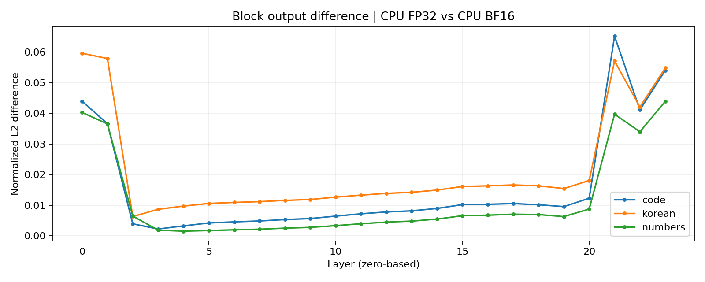
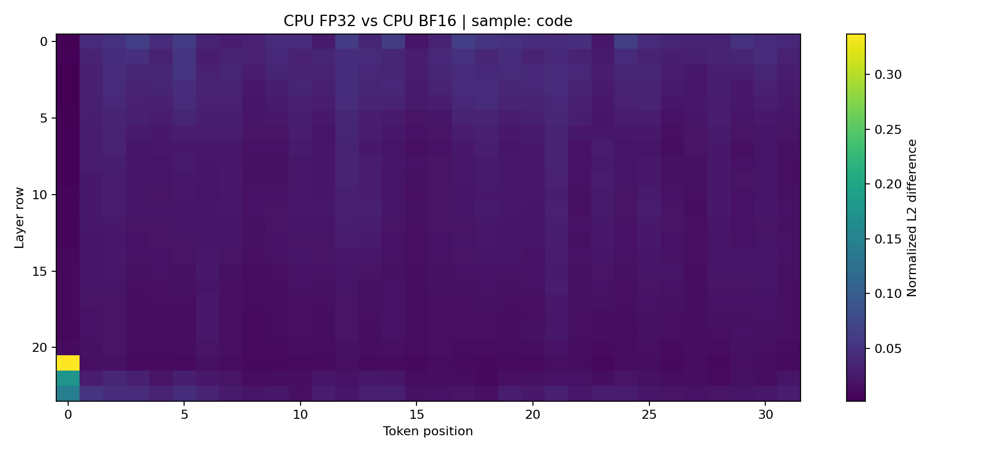

# GPU / TPU 레이어 수치 비교

- 좌측: `cpu` / `cpu`
- 우측: `cpu` / `cpu`
- 모드: `full`
- 비교 tensor 수: 318
- 비유한 값이 있는 tensor 수: 0
- 의도적으로 허용한 설정 차이: ['dtype']
- 계측 영향 검사: [{'side': 'left', 'checks': 9, 'changed': 0, 'nonfinite': 0}, {'side': 'right', 'checks': 18, 'changed': 0, 'nonfinite': 0}]

> 이 보고서는 수치 차이를 측정합니다. GPU/TPU 어느 쪽도 자동으로 정답으로 취급하지 않습니다.
> 같은 장비끼리 비교한 결과는 GPU 대 TPU 실측 결과가 아닙니다.
> plain 출력과 detail 출력의 계측 영향이 0이 아니면 내부 단계 값의 해석에 주의해야 합니다.

## 정규화 L2 차이가 큰 tensor

| Tensor | 정규화 L2 | 최대 절대 차이 |
|---|---:|---:|
| korean/layer_000.detail_attention_probs.npy | 0.209924 | 0.370205 |
| code/layer_000.detail_attention_probs.npy | 0.187156 | 0.336927 |
| numbers/layer_000.detail_attention_probs.npy | 0.186599 | 0.501372 |
| korean/layer_000.detail_context.npy | 0.139345 | 0.032167 |
| code/layer_000.detail_context.npy | 0.135554 | 0.0539076 |
| numbers/layer_000.detail_context.npy | 0.11812 | 0.0870469 |
| korean/layer_000.detail_attention_output.npy | 0.100686 | 0.0168191 |
| code/layer_023.detail_context.npy | 0.0994459 | 0.65425 |
| korean/layer_000.detail_gate_proj.npy | 0.0882993 | 1.31584 |
| korean/layer_000.detail_gated_product.npy | 0.0845855 | 0.431378 |
| korean/layer_000.detail_silu_gate.npy | 0.0834412 | 0.760906 |
| code/layer_000.detail_silu_gate.npy | 0.0762082 | 0.571273 |
| korean/layer_023.detail_context.npy | 0.0754366 | 0.725265 |
| code/layer_000.detail_gate_proj.npy | 0.075145 | 0.78423 |
| code/layer_000.detail_gated_product.npy | 0.0693935 | 0.22077 |
| korean/layer_012.detail_down_proj.npy | 0.0685702 | 0.178977 |
| korean/layer_012.detail_v_proj.npy | 0.0684931 | 0.245933 |
| korean/layer_012.detail_gated_product.npy | 0.0671496 | 0.244228 |
| code/layer_021.output.npy | 0.065225 | 23.0304 |
| code/layer_022.input.npy | 0.065225 | 23.0304 |

## 지표 해석

- 정규화 L2 = ‖A−B‖₂ / max(‖A‖₂, ‖B‖₂, 1e−30).
- 허용치 초과: |A−B| > atol + rtol × max(|A|, |B|). 기본값은 진단용이며 산업 표준 합격 기준이 아닙니다.
- 원소별 지표 계산은 CPU FP64로 수행합니다. NaN/Inf는 정상 차이로 평균 내지 않습니다.
- 실제 logits는 metrics.csv의 top1_agreement와 최소 1·2위 margin을 함께 확인합니다.
- FP64 matmul 기준 대비 값은 각 실행 폴더의 reference_metrics.json에 있습니다.

## 레이어별 차이

## 토큰별 차이

Heatmap은 첫 번째 sample입니다. 나머지 sample의 정확한 값은 token_metrics.csv에 있습니다.
